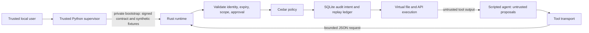

# Architecture and protocol

> Historical Phase 1 baseline. For current Phase 2 behavior, trust boundaries,
> tests and limitations, read the [Phase 2 engineering report](phase2-engineering-report.md).

## Compact architecture



The supervisor creates an ephemeral 256-bit HMAC key, task capability identifier,
and session identifier. It materializes a disposable sample repository for inspection
and sends its synthetic snapshot to the runtime. Tools operate exclusively on the
runtime's in-memory maps. The physical sample files are not authority-bearing inputs
and are not modified by simulated writes.

One runtime process serves one task over inherited stdin/stdout. There is no network
listener. The first frame is trusted bootstrap; after readiness every frame is parsed
only as an untrusted `ToolRequest`. No agent request can replace the key, policy,
contract, fixture registry or clock. The task/capability IDs are channel-bound scope
identifiers, not independently sufficient bearer authentication for remote clients.
The inherited channel and trusted launcher are part of the security boundary.

## Authorization and execution

1. Require strict JSON fields and bounded framing; reject unknown operations.
2. Match the task and capability against the verified startup contract.
3. Use the runtime clock to reject expired contracts.
4. Reject ambiguous or noncanonical resource syntax and oversized bodies.
5. Enforce reserved sensitive path segments (`.env`, `.git`, `secrets`, `credentials`).
6. Require an exact operation/resource grant. There are no globs or prefix grants.
7. If specified by the grant, authenticate an exact-action approval and its expiry.
8. Evaluate the compiled-in Cedar policy using trusted context. Deny policy errors.
9. Prepare a virtual outcome; fail closed if a read/API fixture is absent.
10. Atomically reserve the approval nonce and write audit intent in SQLite.
11. Execute in memory; mark the audit record executed; return a labeled result.

Most invariants reside in Rust because they involve cryptography, parsing and state.
Cedar is a deliberately small additional policy predicate over validated context;
this milestone does not claim a rich Cedar ABAC model. Context is never accepted from
the agent. The compiled policy is the deployment artifact; editing its source requires
rebuilding. The runtime denies on *any* Cedar evaluation error, stricter than Cedar's
usual skip-on-error combination behavior.

## Wire examples

After trusted bootstrap and `{"ready":true}`:

```json
{"task_id":"report-task","capability_id":"<assigned-id>","operation":"read_file","resource":"README.md","body":"","approval":null}
```

A response contains `decision`, a fixed `reason` code, `executed`, `data`,
`provenance`, `event_id`, and `authorization_ns` (available for allowed operations). Agent-controlled
text is never a policy context or an approval. `REQUIRE_APPROVAL` has `executed=false`.
Parser errors produce a sanitized denial. Oversized/truncated frames, clock failure,
audit failure, and transport failure stop execution; the client has no fallback tool.

## Task contracts and approval authority

`contracts/report-task.json` is a human-reviewable trusted template. The supervisor
assigns IDs and converts TTL to absolute Unix seconds. Contracts are signed over the
exact UTF-8 payload bytes with domain `sentinel-contract-v1\0`. The Rust verifier
checks HMAC before parsing. Contract TTL is at most one hour at startup.

The separate `sentinel-approval-v1\0` domain prevents cross-type signature use.
An approval binds task, capability, session, operation, resource, SHA-256 of the body,
expiry (at most five minutes and no later than the task), and a random nonce.
The `(session, nonce)` SQLite primary key enforces one use, including after restarting
with the same trusted bootstrap and database. Invalid approval attempts do not consume
a valid nonce. A crash after nonce reservation may consume an approval without execution;
retry requires a new explicit approval. An approval cannot widen a contract.

Trusted key possession is the prototype's controller authentication. There is no
agent-callable approval issuance endpoint. `Supervisor.approve()` is explicitly a
trusted test/controller API, not an agent tool. Production authenticated human approval
and permission-change management are deferred; they must not be inferred from this API.

## Resource and audit semantics

Paths are ASCII relative virtual keys. Empty/dot/parent segments, absolute paths,
backslashes, percent escapes, NUL, and non-ASCII characters are rejected. Simulated APIs
use opaque `sim:name` identifiers. There are no links, DNS, redirects, mounts, sockets,
or real network requests, so this is not evidence of real-filesystem race resistance.

Audit columns are sequence, Unix timestamp, trusted task ID, normalized operation,
decision, fixed reason and execution status. Raw resources, agent task IDs, content,
keys, signatures and approval payloads are excluded. A trusted launch may only use
nonconfidential task IDs. Query with standard SQLite tools, or use the demo's readable
JSON report. The private temporary directory has mode 0700; a custom audit path is the
trusted caller's responsibility. SQLite is durable local metadata, not a tamper-proof log.

Audit intent and approval reservation precede the virtual side effect. A crash between
execution and its audit update can leave `executed=0` despite an in-memory effect;
`executed=0` for an ALLOW intent therefore means completion was not confirmed. State is
volatile and discarded on process exit. No exactly-once claim is made for future real APIs.

Limits: 64 grants, 128 initial fixtures, 32 KiB per content/body, 240-byte resources,
65,536-byte request frames and 10,000 requests per process. Bootstrap is separately
bounded. These are basic resource bounds, not comprehensive denial-of-service protection.

## Phase 1 tool surface and symlinks

The prior unprotected comparison executor was removed from the active source tree.
The demo, benchmark and agent now use the same centralized Rust gateway; there is no
agent-selectable backend or fallback. Tests verify that the removed module is absent.
The trusted test suite may create controlled fake subprocesses to test transport failure;
these are not agent tools. Neither the agent nor untrusted content is evaluated as Python.

Virtual files have only string values; there is no symlink node type or symlink operation.
Host symlinks cannot influence the in-memory snapshot. Tests replace both read and write
paths in the disposable sample with host symlinks and verify that target data is neither
read nor changed. This tests non-use of host paths, not symlink-safe host execution.

The client serializes requests, enforces an end-to-end send/read deadline, bounds response
size and validates decision/output consistency. A partial response, invalid response or
closed connection permanently closes that client; subsequent requests cannot fall back.
Timeout is an unknown outcome for a request already sent: authorization may have allowed
an action before its response was lost. The client does not retry automatically.

Each successful protocol response carries the generated SQLite event ID. The demo
checks decision, reason and execution status against that exact audit record. Raw paths,
request bodies and tokens remain excluded from audit storage.

## Public candidate extension

`sentinel_sdk` supplies typed Proposal/Result and a trusted session factory. It reuses
Supervisor and the Rust gateway; it is not a Python sandbox. `sentinel_sync` is separate
outbound telemetry with explicit consent, native credential storage and a bounded queue.
No cloud response creates local permissions. `cloud/` hosts identity, pairing and metadata
in Workers/D1. `web/dist` contains the static public site and account dashboard; Pages
Functions forward only `/api/` to the fixed Worker binding. The existing `dashboard/dist`
remains the loopback-only local administrator UI. These are distinct authority domains.

The online user journey is verified with local Wrangler/D1, two synthetic identities,
the real SDK/Rust gateway and Chrome. GitHub OAuth is tested with a mock upstream;
production GitHub/Cloudflare and native OS secure stores remain publication gates.
