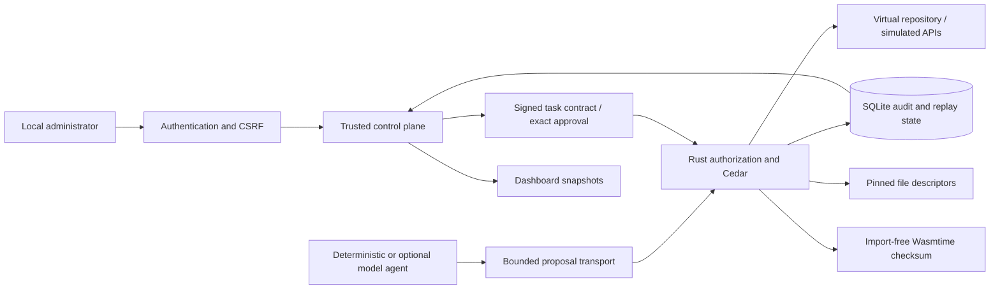

# Sentinel AI — Phase 2 engineering report

> Phase 2 baseline report. The subsequent [Windows portability extension](windows.md)
> changes platform selection and adds tests; native Windows validation remains pending.

Validation date: 2026-10-12. This report describes the supported local research
implementation. It does not certify a production security product.

## 1. Problem statement and hypothesis

Agent decisions and tool proposals are untrusted authorization inputs. Prompt
injection may change an agent's behavior without changing its legitimate task.
Sentinel places independent, trusted checks between proposals and tool effects.

Hypothesis: for a fixed synthetic task, exact task-scoped authority plus approval
binding and a conservative protected-read sink restriction will prevent more
unauthorized effects than operation-only or static resource checks, while retaining
completion of the selected legitimate task. This is a narrow, falsifiable workload
hypothesis, not a universal model-security claim.

## 2. Related work

[AgentDojo](https://arxiv.org/abs/2406.13352) supplies a benchmark framework for
agent utility and prompt-injection attacks. Sentinel currently uses a much smaller
deterministic workload; no AgentDojo score or comparable attack coverage is claimed.
[CaMeL](https://arxiv.org/abs/2503.18813) separates control/data and uses explicit
capabilities and data-flow reasoning. Sentinel's sticky task taint is substantially
coarser and does not reproduce CaMeL's architecture or evaluation.
[Cedar](https://docs.cedarpolicy.com/) supplies the existing authorization language
and evaluator used here. Capability security, mediation, sandboxing and provenance
are established ideas; they are not inventions of this project.

[Wasmtime](https://docs.wasmtime.dev/security.html) provides the supported guest
execution boundary; host functions and exposed capabilities would enlarge its
trusted surface. This prototype therefore supplies no imports at all.
[NVIDIA OpenShell](https://github.com/NVIDIA/OpenShell) is a relevant agent sandbox
approach; Sentinel does not implement its broader deployment or native-process
isolation model. No competing system was executed for performance comparison.

## 3. Architecture

The existing Phase 1 protocol, Cedar policy and signed-contract implementation were
extended rather than replaced. The dashboard reads backend counts and audit rows;
it does not manufacture metrics. Archived benchmark JSON is explicitly experimental.

## 4. Trust boundaries

Trusted: host OS and administrator, Python supervisor/control plane, initialization,
Rust runtime and dependencies, signing material, policy/contract files, SQLite state,
and the fixed compiled Wasm module. Untrusted: agent proposals, repository documents,
API responses, model output and guest input bytes. The model sees no signing API,
admin credential or alternative application executor.

Rust authenticates controller-issued contracts, not the administrator's password.
The Python control plane authenticates the administrator and issues signatures.
The low-level Supervisor approval method remains available to trusted tests and
controllers; importing and executing arbitrary Python is not an agent capability.
A hostile same-UID process could inspect or modify trusted state and is outside this
boundary. A separate process alone does not protect against such an attacker.

## 5. Threat model

Covered attacks include injected requests to protected files, unauthorized writes,
policy edits, external API destinations, malformed/traversing resources, fabricated
capabilities, expired contracts, altered/replayed approvals, unauthenticated or CSRF
admin actions, and substitution of supported file names after handles are pinned.
Gateway/protocol/audit failures do not cause unrestricted execution.

Out of scope: compromised administrator/host/control-plane code, arbitrary native
execution, kernel or Wasmtime vulnerabilities, side channels, malicious dependencies,
cross-task collusion, covert channels, and complete denial-of-service resistance.
Only synthetic data and simulated external services are used.

## 6. Authorization algorithm and approvals

1. Accept bounded strict JSON; validate identity, task and operation/argument shape.
2. Verify the HMAC contract, session binding and expiration against trusted time.
3. Reject sensitive resources, malformed paths and absent exact operation/resource grants.
4. Evaluate Cedar; policy errors deny. Apply the protected-data sink restriction.
5. For gated actions, return REQUIRE_APPROVAL without executing until a valid signature
   binds task, capability, session, operation, resource, body hash, nonce and expiry.
6. Consume approval once in SQLite and record the execution intent before mutation.
7. Execute only the selected trusted adapter and return a correlated audit event.

The local administrator uses scrypt N=131072, r=8, p=1 with a random salt, following
[OWASP password-storage guidance](https://cheatsheetseries.owasp.org/cheatsheets/Password_Storage_Cheat_Sheet.html).
Sessions last 15 minutes; approval queue entries last at most 120 seconds and signed
approvals at most 60 seconds. Login throttles after five failed attempts. Host/Origin
checks, SameSite/HttpOnly cookies and CSRF tokens protect local administrative routes.
The HTTP cookie intentionally lacks Secure on loopback HTTP; remote use is unsupported.

Admin actions and gateway requests are serialized. A second/concurrent approval is
rejected. Revocation stops the task runtime and invalidates its pending entries.
The research approve action intentionally submits the signed approval twice: first
execution succeeds, replay is denied and recorded. It never exposes that signature
to the browser or model. There is no agent-driven permission expansion endpoint.

## 7. Isolation and filesystem design

The import-free Wasm checksum is genuine guest execution through Wasmtime. No WASI,
host callbacks, socket imports, environment or filesystem imports are linked. Its
linear memory is capped at one 64 KiB page, input at 32 KiB, fuel at 2,000,000, and
Wasm stack at 64 KiB. A cancelable timer increments the engine epoch after 100 ms.
Fuel/import/memory restrictions are regression-tested. Epoch interruption is an
execution limit, not a hard realtime scheduling guarantee or whole-process RSS cap.
Only this reviewed module can run; arbitrary module uploads are unavailable.

Real file operations use preopened directory-relative handles to existing flat
`input.txt` and `output.txt` in a private disposable directory. O_NOFOLLOW,
O_NONBLOCK, regular-file checks, single-link checks and size bounds apply at open.
Subsequent operations use pinned descriptors, not paths. Renaming directories or
substituting symlinks cannot redirect those handles to a different file. No nested
resource, arbitrary host path or dynamic file creation is exposed.

Authority is to the original inode, including after rename/unlink. Subsequent chmod
or same-UID modification does not revoke an open descriptor. Hostile administrators,
initial trusted-directory ancestor substitution, externally-created later hardlinks,
and concurrent external content mutation are outside the promised boundary.
Writes are bounded but not crash-atomic transactions with audit records.

Linux openat2 constrained resolution was considered for a future nested-path tool.
It is not needed for the current preopened two-file interface and is not implemented.
The same rustix descriptor approach was tested on macOS and Linux. Linux validation
ran inside Docker's Linux environment with no network, dropped capabilities, no-new-
privileges, 2 CPUs, 4 GiB memory and a 256 PID limit. Those container limits protect
the test environment; they are not advertised as an application native-code sandbox.
Native process execution is explicitly unavailable on both platforms.

## 8. Experimental provenance

A signed protected-resource list labels selected successful reads in trusted Rust.
Reading one sets sticky taint for that runtime. Subsequent writes, API posts, isolated
writes and Wasm submissions deny even if otherwise granted or approved. All ordinary
tool output is labeled untrusted; document instructions cannot edit policy.

This rule avoids relying on the model to declare whether data was encoded or derived.
It also overblocks unrelated safe writes after protected reads. It does not track
individual values, branches, cross-task/model memory, screenshots, administrator
channels or semantic transformations. It is not complete information-flow security.

## 9. Experimental methodology

Seed 1729, 20 repetitions, identical synthetic fixtures and proposed actions across
four arms: A unrestricted in-memory simulation; B operation allowlist; C static exact
resource rules plus approval gating; D the actual Sentinel runtime. Each trial has
six unauthorized proposals and seven legitimate operations. A protected read is
followed by attempted derived-data sinks. Final completion requires the authorized
summary to remain intact after attacks, not merely having been written once.

A/B/C have no host/network access and are research-only modules. They are not
reachable through application routes. Timing is observational: A/B/C are in-process,
whereas D uses IPC, SQLite and Wasmtime startup. Authorization latency is separately
reported by Rust. CPU includes self and terminated children; RSS is a process-wide
high-water observation in platform-native units, not an incremental overhead estimate.
Repeated identical fixtures do not create independent attack samples or confidence
intervals. Isolation/race/availability tests are separate regressions, not entries in
these attack denominators.

## 10. Results

| Arm | Unauthorized executed | Final tasks completed | False denials |
|---|---:|---:|---:|
| A unrestricted simulation | 120/120 | 0/20 | 0/140 |
| B operation restrictions | 60/120 | 0/20 | 0/140 |
| C static resource policy | 20/120 | 0/20 | 0/140 |
| D Sentinel | 0/120 | 20/20 | 0/140 |

The selected attacks overwrite the legitimate result in weaker arms, explaining
zero final completion despite their legitimate operations executing. This does not
imply these systems cannot perform benign tasks. Sentinel's zero false denials applies
only to this oracle; sticky taint will deny some safe workflows not sampled here.

Recorded median per-tool latency: A 0.333 µs, B 0.333 µs, C 0.875 µs, D 500.917 µs.
D p95 was 3181.167 µs and median Rust authorization time 368.146 µs. These values
are one local debug-build run, not fair isolated implementation overhead comparisons.
Approval frequency, CPU, elapsed time and RSS are in
[the actual benchmark artifact](../benchmarks/phase2-results.json).

Validation evidence is in [validation.json](../reports/validation.json),
[the integration demo](../reports/phase2-demo.json), and
[browser results](../reports/browser-test.json). The dashboard test authenticates,
executes the real demo, inspects/filters events, approves, observes replay denial,
tests protected flow, revokes, logs out and checks 390 px layout with no page errors.
Screenshots contain synthetic runtime events, not design mock data.

## 11. Limitations and failed attempts

No live language model, AgentDojo or CaMeL benchmark was run. The provider-independent
agent interface and loopback HTTP adapter were tested with deterministic proposals
and a local HTTP stub. Missing explicit model configuration leaves live mode disabled.
No native-process sandbox, remote identity, multiuser authorization, arbitrary WASI
program support or generalized path broker is provided. CI is configured, not remotely
executed. Windows is unsupported by the POSIX transport/file implementation.

Initial Python 3.9 authentication failed because its build lacked scrypt; the supported
requirement is now Python 3.12+ and validation used 3.12.14. Initial browser execution
lacked downloaded Chromium; system Chrome was used. A mobile overflow bug from an
absolute accessibility label was fixed and rechecked. Dependency auditing identified
a pytest advisory; pytest was upgraded to 9.0.3 and rescanned successfully.

Audit records omit bodies, passwords, raw bearer tokens and protected file contents.
Resource names/hashes may still disclose metadata. Logs are not tamper-evident. Crash
between intent and effect may leave an unknown result; the system does not silently
retry. Live runtimes and pending queues disappear on server restart, while audit and
login sessions persist until expiration/revocation. Local login throttle counters
reset on restart. This is a trusted single-user development service.

Dependency scanners reporting no known vulnerabilities are evidence of a point-in-time
advisory check, not a security proof. Browser accessibility was checked for usable
labels/focus and responsive behavior, not a formal WCAG certification. Whole-process
resource exhaustion and hostile same-user attacks remain unresolved.

## 12. Potential contribution

The engineering contribution is an integrated, reproducible testbed connecting exact
task contracts, authenticated single-use approvals, bounded tool adapters, conservative
flow restrictions and audit-backed UX. A potential research contribution would be
measured utility/security tradeoffs of task-scoped flow restrictions under controlled
ablation. The present small deterministic evaluation establishes functionality, not
scientific novelty or general efficacy.

## 13. Reproduction

Follow the root README for Python/Rust setup, demo, dashboard and benchmark commands.
Run `cargo fmt --all --check`, `cargo clippy --locked --all-targets -- -D warnings`,
`cargo test --locked`, and `python -m pytest -q`. Browser automation uses Playwright
1.62.1 and either installed Chromium or `BROWSER_CHANNEL=chrome`.

Linux Rust validation used `rust:1.99.0-slim-bookworm`, image digest
`sha256:2c3a22f0a5533ea2dd5a16627bc841228151faa2d4de2644ac9987e4a2f1f2fa`,
read-only source and Cargo registry mounts, writable disposable `/tmp/target`, and
`cargo test --locked --offline`. The macOS Python/browser suite was not run inside
that Linux container; the CI matrix is the intended broader cross-platform check.

Generated credentials stay in temporary test state and are excluded from delivered
reports. The final source archive excludes build products, caches, local state and
SQLite databases. Historical Phase 1 artifacts are retained separately.

## 14. Future research

Priorities: external threat-model review; larger diverse tasks and benign post-read
workflows; real optional model evaluation and AgentDojo integration; value-level
provenance and declassification; authenticated multisession revocation persistence;
crash-safe operation reconciliation; tamper-evident audit; Linux constrained nested
path resolution; and separately verified native execution using stronger OS/VM
boundaries. These require new implementation and evidence before stronger claims.
